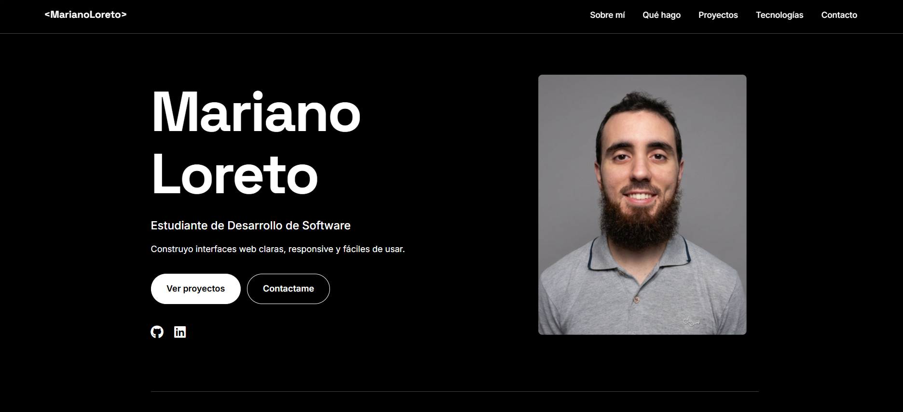

# Portfolio - Mariano Loreto



## Descripción

Portfolio personal de **Mariano Loreto**, estudiante de Desarrollo de Software en el IFTS 16. Es una página web de una sola pantalla donde presento quién soy, qué hago, los proyectos que desarrollé y las tecnologías que manejo y estoy aprendiendo.

El sitio está maquetado con HTML y CSS, con un diseño en blanco y negro, tipografías de Google Fonts (Space Grotesk e Inter) e iconos de Font Awesome. Es completamente responsive y el menú de navegación se convierte en hamburguesa en pantallas chicas, sin usar JavaScript.

## Secciones

- **Inicio:** presentación y foto de perfil con efecto hover.
- **Sobre mí:** breve presentación, habilidades blandas y formación.
- **Qué hago:** servicios que ofrezco (maquetación web, diseño responsive e interfaces cuidadas).
- **Proyectos:** NeoBarber y Del Mate Club, con enlace a cada uno.
- **Tecnologías:** tabla con lo que sé y lo que estoy aprendiendo.
- **Contacto:** formulario de contacto.

## Tecnologías utilizadas

- HTML semántico
- CSS (Flexbox, media queries, variables, pseudoclases y pseudoelementos)
- Git y GitHub

## Estructura del proyecto

```
├── index.html
├── styles.css
├── README.md
└── assets/
    └── img/
        ├── favicon.svg
        ├── Mariano.png
        ├── neobarber.jpg
        ├── del-mate-club.jpg
        └── sample.png
```

## Autor

**Mariano Loreto**  
GitHub: [LoretoMariano](https://github.com/LoretoMariano)